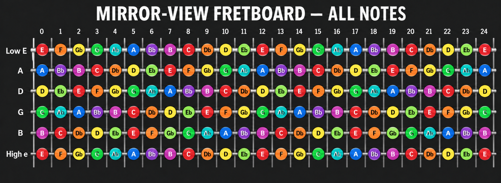

# The Great Gig in The Sky — Vocal Guitar Tab

Electric-guitar arrangement in right-handed mirror view. The thick low E string is the top row; the thin high e string is the bottom row.

## Section 1 — Initial entry and peak (1:07–1:45)

```text
  (1:07 — Vocal entry)
  Gm7                               C9
E|-------------------------------------------------------------|
A|-------------------------------------------------------------|
D|-------------------------------------------------------------|
G|--7/12----12--------------------12-------------------12~-----|
B|-------11------13b15r13--11---------15--13---11--13----------|
e|-----------------------------/15-----------------------------|

  Gm7                                   C9
E|-------------------------------------------------------------|
A|-------------------------------------------------------------|
D|-------------------------------------------------------------|
G|----------------12~----12p10-12p10---------------------------|
B|--13b15r13--11------------------------13b15r13--11--13-------|
e|-------------------------------------------------------15~---|

  (1:22 — Build-up)
  Gm7                                    C9
E|-------------------------------------------------------------|
A|-------------------------------------------------------------|
D|-------------------------------------------------------------|
G|-----------------12-14-14b15r14-12-------------------12------|
B|--13b15~---11-13--------------------13-15~-----13-15----15~--|
e|-------------------------------------------------------------|

  Gm7                                    C9
E|-------------------------------------------------------------|
A|-------------------------------------------------------------|
D|-------------------------------------------------------------|
G|--------12-14-14b15r14--12-----------------------------------|
B|--13-15---------------------15p13\11---13b15r13-11-13~-------|
e|-------------------------------------------------------------|

  (1:36 — High peak)
  Gm7                                    C9
E|-------------------------------------------------------------|
A|-------------------------------------------------------------|
D|-------------------------------------------------------------|
G|--------------------15p14--------------15b17~---15-14-12-----|
B|--13b15r13-11-13/15-------15~----13-15-------------------15--|
e|-------------------------------------------------------------|

  Gm7                                    C9
E|-------------------------------------------------------------|
A|-------------------------------------------------------------|
D|-------------------------------------------------------------|
G|--14b15r14p12-----12~----------------------------------------|
B|---------------15-------13b15r13p11----11~-------------------|
e|------------------------------------13-----------------------|
```

## Section 2 — Soulful response (1:45–2:25)

```text
  (1:45 — Mellow response)
  Gm7                                   C9
E|-------------------------------------------------------------|
A|-------------------------------------------------------------|
D|-------------------------------------------------------------|
G|--10/12\10~----10b12r10--8-7----------7h8p7------------------|
B|------------------------------10p8~----------10-8-10~--------|
e|-------------------------------------------------------------|

  Gm7                                   C9
E|-------------------------------------------------------------|
A|-------------------------------------------------------------|
D|-------------------------------------------------------------|
G|---------9-12-12b14r12-9~-------------12/14\12~----12b14r12--|
B|--8h10~------------------------------------------------------|
e|-------------------------------------------------------------|

  (2:00 — Emotional vibrato build)
  Gm7                                   C9
E|-------------------------------------------------------------|
A|-------------------------------------------------------------|
D|-------------------------------------------------------------|
G|--10--12b14r12p10----10~-------------------------------------|
B|------------------13--------13b15r13p11-13-11~-----11h13p11--|
e|-------------------------------------------------------------|

  Bridge begins near 2:16
E|-------------------------------------------------------------|
A|-------------------------------------------------------------|
D|-------------------------------------------------------------|
G|-------12-14b16-14b16~----14b16r14-12--14b16~----14b16r14-12-|
B|--13-15------------------------------------------------------|
e|-------------------------------------------------------------|
```

## Section 3 — Later vocal passage (from 3:01)

```text
  (3:01 — Soft wailing / slow decay)
E|-------------------------------------------------------------|
A|-------------------------------------------------------------|
D|-------------------------------------------------------------|
G|--12\10/12~----------------------------12\10-----------------|
B|-------------11p10-11~----------------------11p10h11---------|
e|-----------------------------------------------------13b15~--|

E|-------------------------------------------------------------|
A|-------------------------------------------------------------|
D|-------------------------------------------------------------|
G|--------------------12~--------------------------------------|
B|--13b15r13-11-13p11----------13b15r13-11-13~----11\10---------|
e|-----------------------------------------------------11~-----|
```

## Symbols

`h` hammer-on · `p` pull-off · `b` bend · `r` release · `/` slide up · `\` slide down · `~` vibrato

## Fretboard — every note from fret 0 to 24

Standard tuning in the same right-handed mirror view: low E at the top and high e at the bottom.



| String / fret | 0 | 1 | 2 | 3 | 4 | 5 | 6 | 7 | 8 | 9 | 10 | 11 | 12 | 13 | 14 | 15 | 16 | 17 | 18 | 19 | 20 | 21 | 22 | 23 | 24 |
| :--- | :---: | :---: | :---: | :---: | :---: | :---: | :---: | :---: | :---: | :---: | :---: | :---: | :---: | :---: | :---: | :---: | :---: | :---: | :---: | :---: | :---: | :---: | :---: | :---: | :---: |
| Low E | E | F | Gb | G | Ab | A | Bb | B | C | Db | D | Eb | E | F | Gb | G | Ab | A | Bb | B | C | Db | D | Eb | E |
| A | A | Bb | B | C | Db | D | Eb | E | F | Gb | G | Ab | A | Bb | B | C | Db | D | Eb | E | F | Gb | G | Ab | A |
| D | D | Eb | E | F | Gb | G | Ab | A | Bb | B | C | Db | D | Eb | E | F | Gb | G | Ab | A | Bb | B | C | Db | D |
| G | G | Ab | A | Bb | B | C | Db | D | Eb | E | F | Gb | G | Ab | A | Bb | B | C | Db | D | Eb | E | F | Gb | G |
| B | B | C | Db | D | Eb | E | F | Gb | G | Ab | A | Bb | B | C | Db | D | Eb | E | F | Gb | G | Ab | A | Bb | B |
| High e | E | F | Gb | G | Ab | A | Bb | B | C | Db | D | Eb | E | F | Gb | G | Ab | A | Bb | B | C | Db | D | Eb | E |
